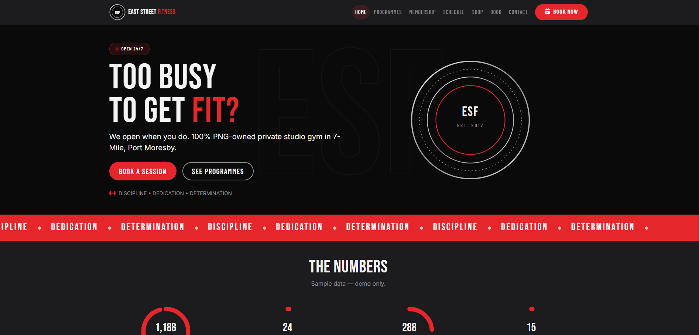
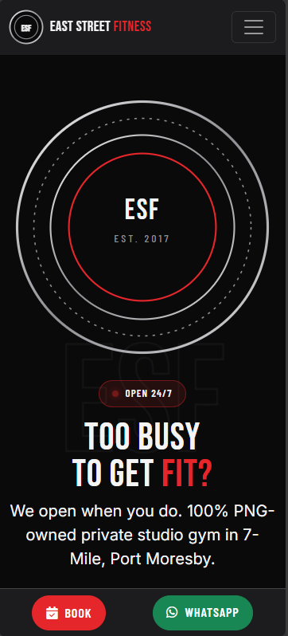

# East Street Fitness — Design Concept

A bold, high-energy website that turns visitors into booked training sessions at a 24-hour PNG-owned gym.

**Status:** Design concept — not the official website. Built by **Tesseract Cloud Technologies, Port Moresby**. Live demo: `https://tesseract-cloud-technologies.github.io/east-street-fitness/`.





---

## 1. Project overview

East Street Fitness (ESF) is a 100% PNG-owned private studio gym at Sky View Estate, 7-Mile, Port Moresby. Founded in 2017, it offers personal training in boxercise, weight training, TRX and circuit, plus nutrition advice, group and corporate sessions, and East Street Fitwear merchandise. It has been reported as the first fitness company on BSP's online payment gateway. Its motto is Discipline. Dedication. Determination.

The site serves busy professionals who need early or late access, women new to strength training, and HR managers buying corporate wellness sessions. The concept exists to convey strength and discipline, make booking possible in three steps, and welcome women and men equally — and to give the owner a reviewable blueprint before any production build.

Everything on this site is **sample content** unless explicitly marked otherwise. No statistics, awards, testimonials, opening hours, prices, or instructor names have been invented beyond what was supplied in the brief.

---

## 2. Objectives and goals

**Business goals**
- Increase memberships and personal-training bookings.
- Enable online payments.
- Grow merchandise sales.
- Attract corporate wellness clients.

**Design goals**
- Convey strength and discipline through type, contrast, and restrained motion.
- Make booking possible in three steps.
- Welcome women and men equally — strength training for everyone.

**Suggested success measures for a live version**
- Home page to booking confirmation rate.
- Booking abandonment at each of the three steps.
- Membership enquiry conversions.
- Shop page product clicks and checkout starts.
- Corporate enquiry form submissions.

These are suggested measures, not supplied data.

---

## 3. Users and user goals

| Persona | Situation | Goal | How the interface helps |
|---|---|---|---|
| Busy professional | Trains before work or late at night; short on time | Book a session in under a minute | Three-step booking wizard, sticky Book button, Live Gym Status badge |
| Woman new to strength training | Intimidated by gyms; wants a welcoming first session | Understand what a session looks like and book with a named trainer | Programme cards, sample instructor names in the booking form, explicit "for all levels" language |
| HR manager | Buying corporate wellness sessions for a team | Get a clear picture of group sessions and a way to enquire | Group and corporate sessions card on the programmes page, contact form |

**Top three user tasks and target taps/clicks**
1. From home page to booking confirmation reference — **3 steps** (choose programme → choose day and time → confirm demo payment).
2. From home page to a membership estimate — **2 taps** (Membership → adjust estimator).
3. From home page to a shop product — **2 taps** (Shop → product card).

---

## 4. Brand and visual identity

Brand cues came from the brief: a black, graphite and steel brand with a circular badge, barbell-plate gauges, and a proposed signal red accent that must stay removable. The visual language leans on high-contrast black and steel, with red reserved strictly for primary buttons and the live status dot.

**Colour palette**

| Swatch | Name | Hex | Role | Contrast note |
|---|---|---|---|---|
|  | Black | #0A0A0A | Page base, hero, footer | AA against white and steel |
|  | Graphite | #1C1C1E | Navbar, cards, alternate sections | AA against white |
|  | Steel Silver (light) | #F4F4F5 | Metallic headings, borders | Decorative gradient stop |
|  | Steel Silver (mid) | #8E8E93 | Secondary text, gauge tracks | AA on black for large text |
|  | Steel Silver (dark) | #D9D9DB | Metallic gradient stop | Decorative |
|  | White | #FFFFFF | Text on dark, card base | AA on black and graphite |
|  | Signal Red | #E5262B | Primary buttons, live status dot | Not used for body text; removable through one CSS variable |

Signal Red is exposed as `--signal-red` in `:root` so it can be swapped or removed in one place without touching component styles.

**Typography**

| Font | Weights | Where used | Why |
|---|---|---|---|
| Bebas Neue | 400 | Headings, hero title, marquee | Condensed display face that conveys speed and strength |
| Barlow Condensed | 500, 600, 700 | Sub-heads, labels, buttons, chips | Narrow uppercase face that keeps dense UI legible |
| Inter | 400, 500, 600, 700 | Body text, forms, small print | Neutral, highly legible body font for long reading and form fields |

**Signature shapes and motifs**
- A circular badge with concentric rings echoing the logo.
- Barbell-plate gauges drawn as SVG rings that fill on scroll.
- Skewed diagonal panels (`skewY(-6deg)`) with counter-skewed content.
- Diamond-plate texture used sparingly as a background.
- A back-to-back man and woman silhouette drawn as SVG.
- A large outlined ESF monogram watermark behind the hero.

**Imagery and icons**
No stock photography is used. The hero badge, silhouettes, and gauges are inline SVG. Image slots are clearly marked and given gradient fallbacks so the layout can be judged without photos. Font Awesome Free 6.5.2 provides icons: dumbbell, hand-fist, circle-nodes, arrows-spin, apple, calendar-check, cart, shirt, bottle, hat, towel.

**Tone of voice**
Bold and direct. Plain PNG English. "Too busy to get fit? We open when you do." rather than "maximise your fitness journey". Sample content is labelled as sample wherever it appears.

---

## 5. UI design system

**Grid and spacing**
Bootstrap 5.3.3 twelve-column grid. Section rhythm uses `py-5` with `clamp()` on display type. Cards share a 16px radius and a single soft shadow token.

**Breakpoints**
Mobile-first, tested at 320, 360, 390, 768, 1024, 1440 and 1920px. The booking wizard is full-width with large thumb-sized slot buttons on phones. The sticky bottom bar appears only on phones.

**Key components and states**

| Component | States |
|---|---|
| Primary button (`btn-signal`) | Default, hover (lift + red shadow), focus-visible, active, disabled |
| Outline steel button | Default, hover, focus-visible |
| Wizard option (programme, day, time) | Default, hover, selected |
| Payment method toggle | Default, active |
| Plate gauge | Empty, filling on scroll, filled |
| Live Gym Status badge | Open 24/7 with pulsing dot |
| Shop product card | Default, hover (lift), add-to-cart |
| Cart drawer | Closed, open, empty, populated |
| Form input | Default, focus (red ring), invalid, valid |

**Animations and reduced-motion fallbacks**

| Animation | Purpose | Reduced-motion fallback |
|---|---|---|
| Diagonal wipe reveals | Energy and movement consistent with the brand | Disabled — content visible |
| Counter rolling to 2017 | Establishes founding year memorably | Disabled — final value shown |
| Plate gauges filling on scroll | Reinforces progress and effort | Disabled — gauges at final fill |
| Slogan marquee (22s linear) | Keeps the motto visible without taking vertical space | Animation paused |
| Live status dot pulse (2s) | Signals real-time status | Disabled — static dot |
| Confetti on booking confirmation | Celebrates the booking | Disabled — no confetti |
| Button lift 2px | Confirms interactivity | Transition duration reduced |

All motion is disabled under `prefers-reduced-motion: reduce`.

**Accessibility decisions**
- Skip link on every page.
- One `<h1>` per page.
- Visible `:focus-visible` ring in Signal Red.
- ARIA labels on all icon buttons and the cart toggle.
- Three-step booking wizard validates each step before advancing and clearly states "This is a demo, no real payment has been processed."
- Minimum 44px tap targets.
- AA contrast for body text; Signal Red not used for body copy.

---

## 6. Page map and user flows

**Sitemap**

```mermaid
flowchart TD
    Home[index.html] --> Programs[programs.html]
    Home --> Membership[membership.html]
    Home --> Schedule[schedule.html]
    Home --> Shop[shop.html]
    Home --> Book[book.html]
    Home --> Contact[contact.html]
    Book --> Wizard[3-step booking wizard]
    Membership --> Estimator[Monthly cost estimator]
    Shop --> Cart[Cart drawer]